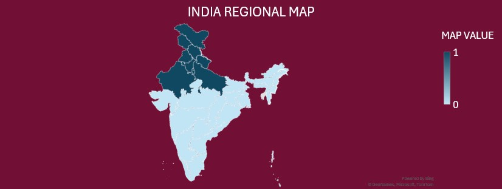
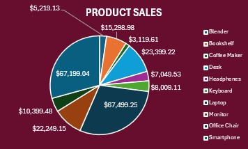
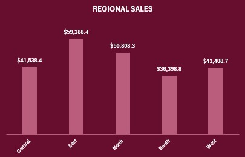
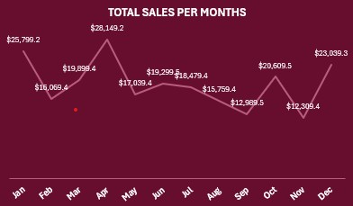
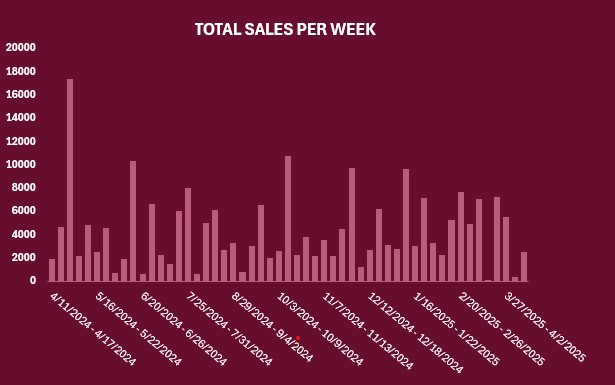

<div align="center">

# 👋 Hi there! Welcome to the Data Intelligence Dashboard


**Excel • Data Analysis • Interactive Dashboard • Customer Transactions**


</div>

---

## 🎯 Project Overview

**Data Intelligence Dashboard** is an Excel-based analytics project built to explore customer transactions, sales performance, product categories, and regional trends. It brings key metrics and charts together in one interactive view, with slicers for **Region**, **Months (Date)**, and **Category**.

> **Visual theme:** Deep burgundy `#5B001E`, with pink accents and high-contrast labels.

## 📊 Dashboard Preview

<div align="center">
  
</div>

## ✨ Dashboard Highlights

- **Total Revenue KPI** — displays the overall revenue figure and responds to the dashboard's connected filters.
- **Top 3 Customers** — highlights the highest-value customers.
- **Product Sales** — pie chart comparing sales across products.
- **Regional Sales** — column chart comparing Central, East, North, South, and West.
- **Monthly Sales Trend** — line chart showing month-by-month sales.
- **Weekly Sales** — column chart showing sales across weeks.
- **India Regional Map** — Filled Map visualization included as a regional visual.
- **Interactive Slicers** — Region, Months (Date), and Category filters.

## 🖼️ Individual Visuals

<table>
  <tr>
    <td align="center" colspan="2">
      <b>India Regional Map</b><br>
      
    </td>
  </tr>
  <tr>
    <td align="center" width="50%">
      <b>Product Sales</b><br>
      
    </td>
    <td align="center" width="50%">
      <b>Regional Sales</b><br>
      
    </td>
  </tr>
  <tr>
<td align="center" width="50%">
  <b>Monthly Sales Trend</b><br>
  
</td>
    <td align="center" width="50%">
      <b>Weekly Sales</b><br>
      
    </td>
  </tr>
</table>
## 🧰 Tools & Techniques

- **Microsoft Excel**
- Data cleaning and preparation
- PivotTables and PivotCharts
- Slicers and date filtering
- Excel formulas and lookup/aggregation functions
- Conditional formatting
- Scenario Manager and Goal Seek
- Regression analysis
- Customer purchase summaries and frequency analysis
- Filled Map chart

## 🗂️ Workbook Analysis Areas

| Area | Purpose |
|---|---|
| Regional Sales | Compare sales across Central, East, North, South, and West |
| Product Sales | Compare product-level sales contribution |
| Monthly Sales | Review sales trends across months |
| Weekly Sales | Review sales movement by week |
| High Value Customers | Rank customers by total purchase amount |
| Frequency Analysis | Count product purchases and compare name lists |
| Regression Analysis | Explore the relationship between quantity and total amount |
| Scenario Summary | Compare Best Case, Normal Case, and Worst Case scenarios |
| Filter Analysis | View transaction subsets by region |

## 🔎 Data Fields

The transaction table includes fields such as:

- Transaction ID and Date
- Customer ID and Customer Name
- Product ID, Product Name, and Category
- Quantity and Unit Price
- Payment Method and Region
- Customer Segment and Customer Since
- Total Amount, Customer Tenure, Current Date, Timestamp, and Month End

## 🎨 Design

The dashboard uses a consistent **`#5B001E` burgundy theme**, pink-toned charts, white labels, KPI cards, and compact visual panels to keep the report readable and cohesive.

## 🚀 How to Explore

1. Open `Data Intelligence Dashboard.xlsx`.
2. Go to the **DASHBOARD** sheet.
3. Use the Region, Months (Date), and Category slicers to filter the dashboard.
4. Review the KPI cards and charts to compare customer, product, regional, monthly, and weekly performance.
5. Visit the analysis sheets for the supporting calculations and summaries.

## 📁 Repository Structure

Keep the image files inside the `Images` folder with these exact filenames. GitHub paths are case-sensitive.

```text
Data-Intelligence-Dashboard/
├── README.md
├── Data Intelligence Dashboard.xlsx
└── Images/
    ├── CUSTOMER TRANSACTION DASHBOARD.jpg
    ├── INDIA-REGIONAL_MAP.jpg
    ├── PRODUCT_SALES.jpg
    ├── REGIONAL_SALES.jpg
    ├── TOTAL-SALES-PER-MONTHS.jpg
    └── TOTAL-SALES-PER-WEEKS.jpg
```


<div align="center">
  
  <p><b>⭐ If you found this project useful, consider starring the repository!</b></p>
  <p><i>Built with Microsoft Excel • Theme: #5B001E</i></p>
</div>
